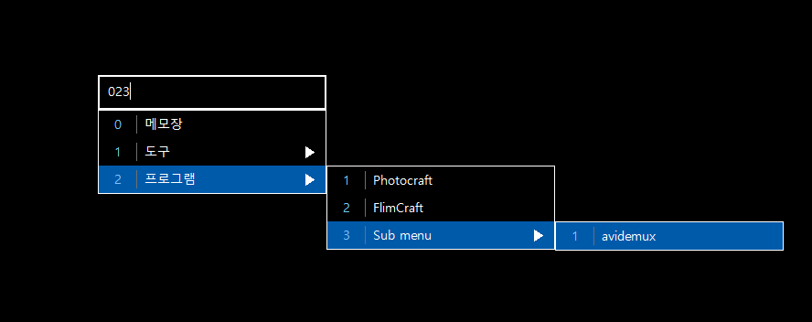
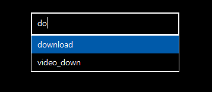
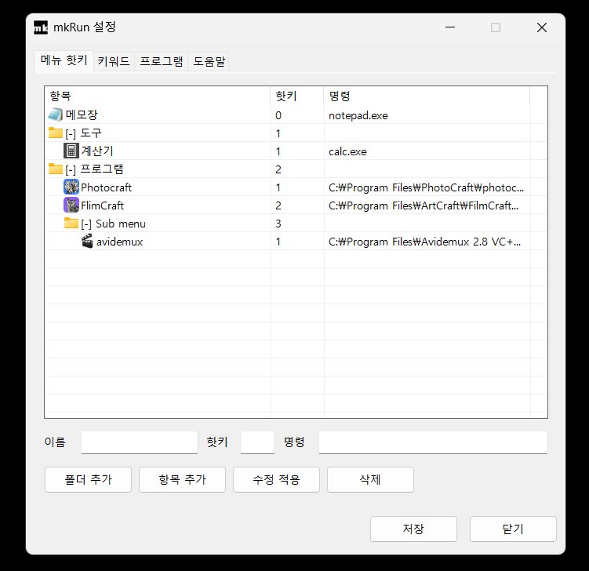
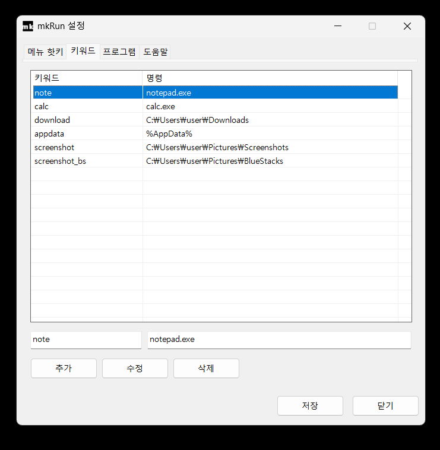

# mkRun

메뉴 핫키와 키워드로 프로그램/폴더/URL을 빠르게 실행하는 윈도우 런처 (Win32 / C++17, 외부 라이브러리 없음)

## 미리보기

| 메뉴 핫키 실행 | 키워드 실행 |
|---|---|
|  |  |

| 설정 - 메뉴 핫키 | 설정 - 키워드 |
|---|---|
|  |  |

## 주요 기능

- **글로벌 핫키** (기본 `Alt+Q`): 언제든지 런처 창 호출 (윈도우 기본 단축키 중복 방지)
- **메뉴 핫키** (기본 호출 키 `0`): 숫자·영문자 키를 이용한 계층형(캐스케이딩) 메뉴 탐색 및 실행
- **키워드 실행**: 키워드 검색 및 실행, 드래그 앤 드롭 순서 변경
- **설정 및 커스터마이징**: 시작 프로그램 등록, 외곽선/배경 색 변경, 한국어/English 지원, `settings.json` 내보내기/가져오기

## 빌드

**Visual Studio**: `mkRun.sln`을 열고 `Release | x64`로 빌드 (결과: `bin\x64\Release\mkRun.exe`)

**CMake (MSVC / MinGW-w64)**

```
cmake -S . -B build
cmake --build build --config Release
```

## 구조

| 파일 | 역할 |
|---|---|
| `src/main.cpp` | 진입점, 트레이 아이콘, 전역 핫키 수신, 우클릭 메뉴 |
| `src/Launcher.*` | 200×30 입력 창 + 캐스케이딩 드롭다운 (키워드 / 메뉴 핫키 모드) |
| `src/Settings.*` | 설정 창 (메뉴 핫키 / 키워드 / 프로그램 / 도움말 탭) |
| `src/Config.*`, `src/Json.h` | 설정 데이터 구조, JSON 로드/저장/내보내기/가져오기 |
| `src/Hotkey.*` | 단축키 문자열 변환, `RegisterHotKey` 및 윈도우 기본 단축키 검사 |
| `src/Util.*` | 문자열 변환, 시작프로그램 등록, 명령 실행, 아이콘 생성 |
| `src/mkRun.rc`, `src/mkRun.ico` | 실행 파일 아이콘 리소스 |

설정 파일: `%APPDATA%\mkRun\settings.json`
